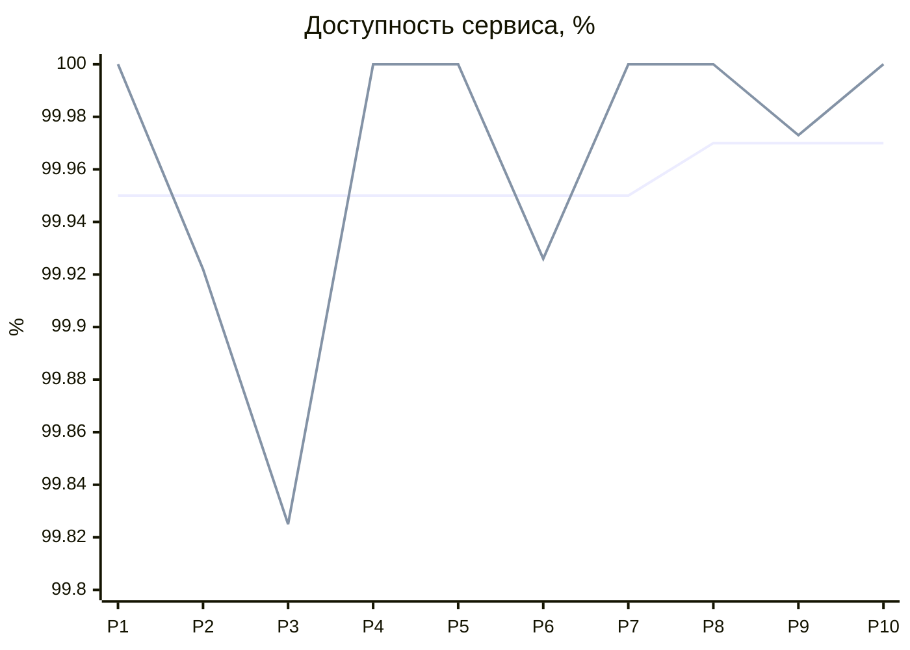
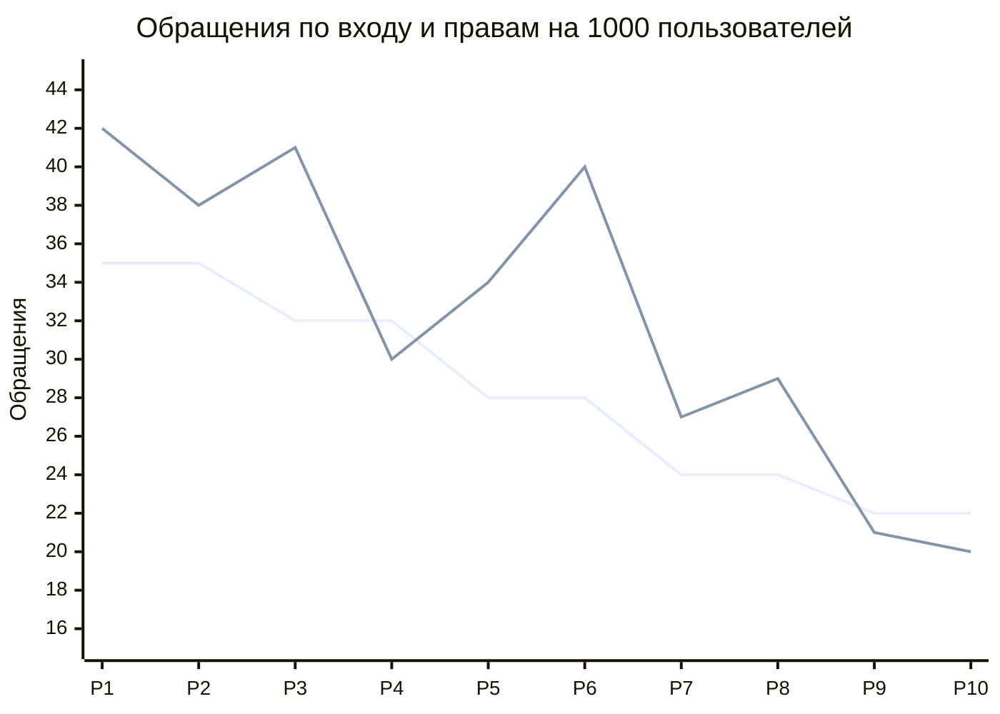

| Поле паспорта           | Краткое описание                                                                     |
| ----------------------- | ------------------------------------------------------------------------------------ |
| Компания и продукт      | Яндекс Практикум. Онлайн-образование для частных и корпоративных клиентов            |
| Масштаб бизнеса         | Оборот из паспорта — 5 226 713 000 руб. за 2025 год                                  |
| Выбранный ИТ-сервис     | Вход через Яндекс ID, проверка прав на курсы и открытие личного кабинета             |
| Пользователи и нагрузка | 44 тыс. пользователей в год, MAU — 22 тыс., вечерний пик — 1 500–2 000 пользователей |
| Данные работы           | Открытые сведения из паспорта и предыдущих работ.                                    |

## 1. Исходная ситуация

В ПР1 установлены следующие обязательства: доступность сервиса не ниже 99,95% за месяц, время входа p95 до 1,5 секунды, загрузка кабинета p95 до 2 секунд и восстановление P1 до 60 минут. В ПР2 определены роли, порядок обработки обращений, согласование изменений и контроль SLA.

В этой работе моделируются десять будущих релизов — с ноября 2026 года по август 2027 года. Их цели: обеспечить стабильный доступ к обучению, ускорить кабинет и уменьшить обращения по входу и правам на курсы. Продажи, платежи и проведение занятий в границы выбранного сервиса не входят.

Каждый релиз занимает один календарный месяц. Длительность составляет от 4 до 4,4 недели и зависит от количества дней в месяце. Обновления выпускаются небольшими частями, а показатели оцениваются за весь месяц.

Предыдущие работы содержат цели SLA, но не реальные результаты мониторинга. Поэтому для начала моделирования задаётся условное состояние **Р0**:

|Показатель|Состояние до Р1|
|---|---|
|Доступность за месяц|100%|
|Время входа p95|1,55 с|
|Загрузка кабинета p95|2,10 с|
|Максимальное время восстановления P1|—, в условном месяце P1 не было|
|Доля неудачных развёртываний|10%|
|Обращения по входу и правам|42 на 1 000 активных пользователей|
|MAU|22 000|

Уже в начальном состоянии скорость немного хуже целей ПР1. Отсутствие P1 не подтверждает, что команда сможет восстановить сервис за 60 минут: это нужно проверить отдельно.

**Все значения Р0, будущие события, расходы и показатели в колонке «факт» являются учебными допущениями. Они не описывают реальные результаты Яндекс Практикума.**

## 2. Команда и стоимость времени

За основу взят состав из паспорта — 25 человек. Над выбранным сервисом работает часть этой команды. Стоимость релиза рассчитывается по затраченным часам.

Ставки ниже — учебная оценка полной стоимости рабочего времени. Они не являются сведениями о зарплатах компании. Для расчёта принято 160 рабочих часов в человеко-месяце.

|Роль|Человек|Ответственность|Стоимость человеко-месяца, руб.|Стоимость часа, руб.|
|---|---|---|---|---|
|Руководитель сервиса|1|SLA, приоритеты, согласования, связь с заказчиком|300 000|1 875|
|Менеджеры продукта и проектов|2|Требования, план релизов и сроки|240 000|1 500|
|Технический руководитель|1|Технические решения, проверка изменений и причин сбоев|360 000|2 250|
|Backend-разработчики|6|Авторизация, сессии, права доступа|280 000|1 750|
|Frontend-разработчики|4|Веб-интерфейс кабинета и сообщения пользователям|240 000|1 500|
|Мобильные разработчики|2|Вход и кабинет в мобильном приложении|250 000|1 562,50|
|QA-инженеры|3|Проверка изменений, входа, прав и отката|180 000|1 125|
|DevOps|3|Мониторинг, выпуск, резервирование и восстановление|300 000|1 875|
|Аналитики|2|Показатели, обращения и поведение пользователей|220 000|1 375|
|UX/UI-дизайнер|1|Понятность интерфейса и сообщений|200 000|1 250|

Поддержка и ИБ участвуют как общие специалисты компании:

|Роль|Стоимость часа, руб.|Участие|
|---|---|---|
|Поддержка|800|Обращения, инструкции и сообщения пользователям|
|Специалист ИБ|2 000|Проверка доступа, уязвимостей и срочных исправлений|

Состав команды в течение десяти релизов не увеличивается. Для P1/P2 предусматриваются дежурный и резервный специалист из DevOps и подготовленных разработчиков. График и возможность подключения проверяются до начала Р1 по ПР2.

В смету включается учебная надбавка за дежурства — **80 тыс. руб. в месяц**.

Кроме работ, перечисленных в таблице релизов, на каждый месяц выделяются общие часы:

|Роль|Часов|
|---|---|
|Руководитель сервиса|16|
|Менеджер проекта|16|
|Технический руководитель|16|
|Аналитик|8|
|Поддержка|16|
|ИБ|4|
|DevOps|24|
|QA|24|
|**Всего**|**124**|

Стоимость этих часов — **193 800 руб. за релиз**. В них входят планирование, отчётность, контроль очереди и сопровождение небольших выпусков. Они учитываются один раз.

Основная инфраструктура в модели стоит **120 тыс. руб. в месяц**. Дополнительные расходы после отдельных событий указаны далее.

## 3. Метрики для сравнения релизов

Во всех десяти релизах используются одни и те же шесть метрик.

|Код|Метрика|Единица и способ расчёта|Начальная цель|
|---|---|---|---|
|Д|Доступность входа и кабинета|% за календарный месяц по мониторингу и подтверждённым простоям|Не ниже 99,95%|
|В|Время входа p95|Секунды; время, в которое укладываются 95% корректных операций входа за месяц|Не более 1,5 с|
|К|Загрузка кабинета p95|Секунды по измерениям загрузки страницы за месяц|Не более 2 с|
|П1|Максимальное время восстановления P1|Минуты от регистрации до восстановления среди P1 за месяц|Не более 60 минут|
|Н|Доля неудачных развёртываний|Развёртывания с откатом или срочным исправлением / все развёртывания × 100%|Не более 10%|
|О|Обращения по входу и правам|Число обращений / MAU × 1 000|Не более 35|

Если P1 в месяце не было, в факте ставится «—». Это не считается восстановлением за ноль минут.

В модели принято **20 небольших развёртываний за месяц**. Один неудачный выпуск означает 5%, два — 10%, три — 15%. Месячный релиз объединяет эти изменения общей целью.

Для будущих расчётов приняты следующие значения MAU:

|Релиз|Р1|Р2|Р3|Р4|Р5|Р6|Р7|Р8|Р9|Р10|
|---|---|---|---|---|---|---|---|---|---|---|
|MAU, тыс.|22|22|23|24|25|26|27|28|29|30|

Рост аудитории — учебный сценарий, а не прогноз компании.

Среднее время обработки обращения принято равным **15 минутам**. При ставке поддержки 800 руб. в час одно обращение стоит **200 руб. рабочего времени**.

В колонке «целевой SLA» указан внутренний контракт команды. Сначала технические цели совпадают с ПР1. Затем команда принимает более строгие цели после проверок.

Остальные условия ПР1, включая RPO, сроки реакции и уведомления, продолжают действовать, хотя не входят в выбранные шесть метрик.

## 4. Десять релизов

В целях, факте и отклонении используется один порядок:

**Д / В / К / П1 / Н / О.**

Отклонение считается как **факт минус цель**. Для доступности положительное значение означает запас. Для остальных показателей положительное значение означает превышение. Разница процентов дана в процентных пунктах.

Часы в составе работ — суммарное время специалистов соответствующей роли. Под «руководителем» далее понимается руководитель сервиса.

|Релиз и горизонт|Цель релиза|Состав работ|Целевой SLA: Д / В / К / П1 / Н / О|Факт: Д / В / К / П1 / Н / О|Отклонение и причина|
|---|---|---|---|---|---|
|**Р1. Ноябрь 2026, 4,3 недели**|Снизить обращения по входу с 42 до 35 на 1 000 пользователей|Сообщения об ошибках: UX 16 ч, frontend 32 ч, QA 16 ч. Отображение прав: backend 24 ч, frontend 24 ч, QA 16 ч. Проверка полного входа и инструкции: DevOps 24 ч, аналитик 8 ч, руководитель 8 ч, поддержка 8 ч|**99,95 / 1,50 / 2,00 / 60 / 10 / 35**|**100 / 1,45 / 2,15 / — / 10 / 42**|**+0,05 / −0,05 / +0,15 / — / 0 / +7**. Ошибка назначения прав вызвала обращения и дополнительные проверки кабинета|
|**Р2. Декабрь 2026, 4,4 недели**|Уменьшить вопросы о доступе к назначенным курсам до 35 на 1 000|Подсказки о доступе: backend 32 ч, frontend 24 ч, QA 16 ч, UX 8 ч. Диагностика Яндекс ID: backend 24 ч, DevOps 24 ч, аналитик 8 ч, руководитель 8 ч. Мера после Р1 — 48 ч|**99,95 / 1,50 / 2,00 / 60 / 10 / 35**|**99,922 / 1,65 / 2,10 / 33 / 10 / 38**|**−0,028 / +0,15 / +0,10 / −27 / 0 / +3**. Отказ зависимости и последующая работа через медленный маршрут|
|**Р3. Январь 2027, 4,4 недели**|Удержать скорость входа в пределах SLA и снизить обращения до 32|Оптимизация сессий: backend 48 ч, DevOps 16 ч, QA 24 ч. Ускорение проверки прав: backend 24 ч, frontend 16 ч, QA 16 ч, техруководитель 8 ч. Мера после Р2 — 64 ч|**99,95 / 1,50 / 2,00 / 60 / 10 / 32**|**99,825 / 1,60 / 2,20 / 76 / 20 / 41**|**−0,125 / +0,10 / +0,20 / +16 / +10 / +9**. Ошибка обновления и неработающий откат; пришлось вернуть более медленную версию|
|**Р4. Февраль 2027, 4 недели**|Снизить обращения до 32 и проверить восстановление после неудачного обновления|Пояснение прав в кабинете: backend 32 ч, frontend 32 ч, QA 24 ч, UX 16 ч. Массовое назначение курсов: backend 40 ч, аналитик 16 ч, QA 24 ч, техруководитель 8 ч. Мера после Р3 — 64 ч|**99,95 / 1,50 / 2,00 / 60 / 10 / 32**|**100 / 1,80 / 2,50 / — / 10 / 30**|**+0,05 / +0,30 / +0,50 / — / 0 / −2**. Права стали понятнее, но новая нагрузка замедлила сервис|
|**Р5. Март 2027, 4,4 недели**|Вернуть скорость в пределы SLA и снизить обращения до 28|Настройка соединений с базой: backend 32 ч, DevOps 24 ч, QA 16 ч. Уменьшение запросов кабинета: frontend 32 ч, backend 24 ч, QA 16 ч. Мера после Р4 — 72 ч|**99,95 / 1,50 / 2,00 / 45 / 5 / 28**|**100 / 1,42 / 1,95 / — / 15 / 34**|**+0,05 / −0,08 / −0,05 / — / +10 / +6**. Несовместимые изменения прав потребовали исправления трёх выпусков|
|**Р6. Апрель 2027, 4,3 недели**|Уменьшить неудачные развёртывания до 5% и обращения до 28|Перевод назначений курсов на новую схему: backend 40 ч, QA 24 ч, техруководитель 8 ч. Настройка поэтапного выпуска: DevOps 24 ч, backend 16 ч, QA 16 ч. Независимые тесты совместимости после Р5 — 56 ч|**99,95 / 1,50 / 2,00 / 45 / 5 / 28**|**99,926 / 1,45 / 1,95 / 30 / 5 / 40**|**−0,024 / −0,05 / −0,05 / −15 / 0 / +12**. Сбой доставки файлов кабинета у внешнего поставщика|
|**Р7. Май 2027, 4,4 недели**|Снизить обращения до 24 и подготовить резерв доставки кабинета|Ускорение чтения профиля: backend 32 ч, frontend 24 ч, DevOps 16 ч, QA 16 ч. Сообщения о состоянии доступа: UX 16 ч, frontend 16 ч, QA 8 ч. Мера после Р6 — 72 ч|**99,95 / 1,50 / 2,00 / 45 / 5 / 24**|**100 / 1,35 / 1,75 / — / 5 / 27**|**+0,05 / −0,15 / −0,25 / — / 0 / +3**. Пользователи неправильно поняли новое сообщение о сессии|
|**Р8. Июнь 2027, 4,3 недели**|Удержать более строгие цели скорости и снизить обращения до 24|Навигация по курсам: UX 16 ч, frontend 32 ч, QA 16 ч. Мобильный кабинет: мобильный разработчик 32 ч, backend 16 ч, QA 16 ч. Мера после Р7 — 48 ч|**99,97 / 1,40 / 1,80 / 45 / 5 / 24**|**100 / 1,52 / 1,92 / — / 10 / 29**|**+0,03 / +0,12 / +0,12 / — / +5 / +5**. Срочное исправление безопасности замедлило обработку сессий|
|**Р9. Июль 2027, 4,4 недели**|Снизить обращения до 22 и подтвердить готовность резервного контура|Подсказки по обращениям: frontend 24 ч, backend 16 ч, QA 16 ч, аналитик 8 ч. Проверка резервирования: DevOps 24 ч, QA 16 ч, техруководитель 8 ч. Мера после Р8 — 48 ч|**99,97 / 1,40 / 1,80 / 45 / 5 / 22**|**99,973 / 1,32 / 1,70 / 10 / 5 / 21**|**+0,003 / −0,08 / −0,10 / −35 / 0 / −1**. Отказ узла базы вызвал простой, но переключение сохранило показатели в пределах целей|
|**Р10. Август 2027, 4,4 недели**|Снизить обращения до 22 и сделать поведение веб- и мобильного кабинета одинаковым|Общие элементы кабинета: frontend 32 ч, мобильный разработчик 32 ч, QA 24 ч, UX 8 ч. Понятное состояние сессии: backend 24 ч, frontend 16 ч, QA 16 ч. Мера после Р9 — 32 ч|**99,97 / 1,40 / 1,80 / 45 / 5 / 22**|**100 / 1,34 / 2,05 / — / 5 / 20**|**+0,03 / −0,06 / +0,25 / — / 0 / −2**. Новая версия поддерживаемого браузера замедлила возврат в кабинет|

В Р6 работа с новой схемой прав и профилактика после Р5 разделены: первая меняет саму схему, вторая создаёт отдельные автоматические тесты совместимости. Их часы не пересекаются.

В модели нет согласованных простоев, исключаемых из расчёта. Подтверждённая недоступность составляет:

- Р2 — 35 минут;
    
- Р3 — 78 минут;
    
- Р6 — 32 минуты;
    
- Р9 — 12 минут.
    

В остальных месяцах событий, соответствующих критериям недоступности из ПР1, нет. При этом отдельные пользователи могут сталкиваться с ошибками и замедлением.

Например, в январе 2027 года 44 640 минут. Для Р3:

**Доступность = (1 − 78 / 44 640) × 100% = 99,825%.**

В четырёх P1 регистрация происходила через две минуты после начала сбоя. Поэтому восстановление от регистрации меньше полного простоя на две минуты. RTO оценивается от начала аварии: в Р3 он составил 78 минут и также нарушен.

## 5. Чёрные лебеди, реакция и профилактика

### Р1. Ошибка назначения прав

**Источник и момент:** люди, первая неделя релиза. При подготовке учебного потока использовали неверный шаблон назначения курсов. Около 8% участников потока не увидели нужные программы. Обращения остались на уровне 42 вместо цели 35.

**Реакция:** поддержку насторожили одинаковые обращения. Руководитель сервиса назначил P2: студенты не могли начать обучение, безопасного обходного решения не было. Приоритет определён по срочности, а не по предположению, что затронуто 8% всех пользователей сервиса.

Технический руководитель организовал исправление назначений и проверку всего списка. По процедуре ПР2 зарегистрировали инцидент, восстановили доступ и открыли проблему. Часть оформления кабинета отложили.

До завершения проверки в течение большей части месяца применялась дополнительная сверка прав. Она увеличила число запросов к базе и месячный p95 кабинета до 2,15 секунды.

**Профилактика в Р2:** проверка списка назначений перед массовым применением. Backend — 16 ч, QA — 16, менеджер проекта — 8, поддержка — 8.

**Стоимость: 48 часов, 64 400 руб.**

### Р2. Отказ зависимости авторизации

**Источник и момент:** внешний поставщик, вторая неделя. Изменение маршрута к Яндекс ID привело к 35 минутам недоступности. После восстановления сервис работал через более медленный маршрут большую часть оставшегося месяца. Поэтому месячный p95 входа составил 1,65 секунды.

**Реакция:** мониторинг зарегистрировал сбой. DevOps открыл обращение смежной команде, руководитель сервиса организовал P1 и сообщения заказчику. Сначала проверили свою инфраструктуру, затем вместе со смежной командой восстановили маршрут. Проверка личности пользователей сохранялась. Из Р3 перенесли часть улучшений интерфейса.

**Профилактика в Р3:** диагностика задержек зависимости, проверка тайм-аутов и согласование обмена уведомлениями. Backend — 24 ч, DevOps — 16, QA — 16, руководитель — 8.

**Стоимость: 64 часа, 105 000 руб.**

**Пробел ПР2:** не определён порядок предварительного уведомления о технических изменениях смежной системы. Руководитель сервиса готовит дополнение к порядку взаимодействия.

### Р3. Не сработал откат

**Источник и момент:** техника, первая неделя после обновления. Миграция базы оказалась несовместима с предыдущей версией приложения. Скрипт отката не восстановил рабочее состояние. Полный простой составил 78 минут, восстановление после регистрации — 76 минут.

Общая ошибка процедуры выпуска затронула несколько небольших изменений. За месяц четыре из двадцати развёртываний потребовали исправления или отката — 20%.

**Реакция:** сбой заметил DevOps. Руководитель сервиса объявил P1 и подключил технического руководителя. После неудачного отката команда перешла к восстановлению из копии. Перед действиями сохранили доступные журналы и состояние системы.

После запуска проверили вход, права и целостность данных. В модели потеря изменений прав составила 2 минуты, журналов безопасности — 10 минут. Эти значения уложились в RPO из ПР1, но срок восстановления был нарушен.

Команда открыла проблему и вернула более медленную рабочую версию. Из-за её использования в оставшейся части месяца скорость не достигла цели. Часть оптимизаций перенесли.

**Профилактика в Р4:** проверка отката вместе с миграцией и полное восстановление на отдельном контуре. Backend — 16 ч, DevOps — 24, QA — 16, технический руководитель — 8.

**Стоимость: 64 часа, 109 000 руб.**

На проверке в конце Р4 восстановление заняло 32 минуты. После этого согласовали внутреннюю цель P1 до 45 минут с Р5.

Для неё принят отдельный план:

**5 минут на передачу + 10 на диагностику и выбор решения + 15 на восстановление + 10 на проверку + 5 запаса = 45 минут.**

Сокращение времени обеспечивают автоматические проверки и заранее проверенные сценарии восстановления. Исходный договорный предел ПР1 остаётся 60 минут. Нарушение Р3 сохраняется в отчёте.

### Р4. Изменился характер нагрузки

**Источник и момент:** рынок и поведение пользователей, вторая неделя. Корпоративный поток одновременно начал проверять назначенные курсы. Пик достиг 2 400 пользователей при 90 запросах в секунду — в пределах ёмкости из ПР1.

Однако запросов к правам оказалось больше, чем в прежнем нагрузочном тесте. Вход замедлился до 1,8 секунды, кабинет — до 2,5. Такой характер обращений сохранялся в течение учебного потока и повлиял на месячные показатели.

**Реакция:** DevOps заметил задержки, аналитик связал их с новым потоком. Технический руководитель решил сократить повторные запросы и настроить соединения с базой. Сначала уменьшили лишние обращения к данным, затем подготовили проверку нового профиля нагрузки. Руководитель перенёс часть мобильных улучшений.

**Профилактика в Р5:** нагрузочный тест с массовой проверкой прав и увеличение ресурсов базы. Backend — 24 ч, DevOps — 24, QA — 16, аналитик — 8.

**Стоимость: 72 часа, 116 000 руб.**

Дополнительные ресурсы стоят в модели **50 тыс. руб. в месяц с Р5**.

### Р5. Несовместимые изменения прав

**Источник и момент:** техника, при поэтапном выпуске. Общий дефект проверки совместимости затронул три небольших обновления. У части студентов пропали назначенные курсы. Неудачные развёртывания составили 15% вместо цели 5%, обращения — 34 вместо 28.

**Реакция:** поддержка и QA получили сообщения о пропавших курсах. Технический руководитель остановил дальнейшее распространение изменений, руководитель сервиса согласовал откат. Сначала восстановили назначения, затем сверили данные и подготовили исправление. Часть новых возможностей перенесли в Р6.

**Профилактика в Р6:** отдельные автоматические тесты совместимости старой и новой схемы прав. Backend — 24 ч, QA — 24, технический руководитель — 8.

**Стоимость: 56 часов, 87 000 руб.**

### Р6. Сбой доставки файлов кабинета

**Источник и момент:** внешний поставщик, середина месяца. После изменения настроек CDN перестала загружаться необходимая часть приложения. Полный простой составил 32 минуты. Доступность снизилась до 99,926%, обращения выросли до 40 на 1 000 пользователей.

**Реакция:** мониторинг обнаружил невозможность открыть кабинет. DevOps зарегистрировал P1 и связался с поставщиком, frontend-разработчик проверил файлы приложения. Руководитель сервиса согласовал временную доставку файлов с основного сервера.

После восстановления сохранили результаты проверки и открыли проблему. Подготовка независимого резерва стала приоритетом Р7, часть интерфейсных работ перенесли.

**Профилактика в Р7:** независимый резерв доставки файлов и проверка переключения. DevOps — 32 ч, frontend — 16, QA — 16, руководитель — 8.

**Стоимость: 72 часа, 117 000 руб.**

Резерв стоит в модели **40 тыс. руб. в месяц с Р7**. При проверке нужно убедиться, что у него нет общей критической зависимости с основным способом доставки.

**Пробел ПР2:** не описан порядок такого переключения. По результатам проверки команда добавляет рабочую инструкцию.

### Р7. Пользователи неправильно поняли сообщение

**Источник и момент:** люди, сразу после изменения интерфейса. Сообщение «сессия завершена» часть студентов восприняла как потерю доступа к курсу. Технически права сохранялись, но обращения составили 27 вместо цели 24.

**Реакция:** повторяющиеся вопросы заметила поддержка. Аналитик проверил причины обращений, руководитель сервиса согласовал изменение текста. Сначала поддержке выдали понятное объяснение, затем дизайнер и frontend-разработчик подготовили новый вариант сообщения. Отложили часть оформления навигации.

**Профилактика в Р8:** проверка сообщений на небольшой группе пользователей перед общим выпуском. UX — 16 ч, frontend — 16, поддержка — 8, аналитик — 8.

**Стоимость: 48 часов, 61 400 руб.**

В конце Р7 резерв доставки дважды переключили за 8 и 10 минут. Скорость входа и кабинета также улучшилась. По результатам работ руководитель сервиса и заказчик согласовали с Р8 внутренние цели: доступность 99,97%, вход до 1,4 секунды, кабинет до 1,8.

Эти проверки подтверждают готовность переключения. Выполнение месячной доступности дальше проверяется по фактической работе сервиса.

### Р8. Срочное исправление безопасности

**Источник и момент:** техника, первая неделя. В используемом компоненте обработки сессий обнаружили опасную ошибку. Сведения о ней получила служба ИБ и передала техническому руководителю.

Для защиты потребовалось срочное обновление. Оно добавило проверки, которые продолжали работать до оптимизации в Р9. Из-за этого месячный p95 входа вырос до 1,52 секунды, кабинета — до 1,92. Два развёртывания потребовали срочного исправления.

**Реакция:** руководитель сервиса согласовал срочное изменение по ПР2. Сначала установили защитную меру, затем проверили вход, права и нагрузку. Защиту сохранили, а оптимизацию перенесли в Р9. Пожертвовали скоростью и частью запланированных функций.

**Профилактика в Р9:** проверка используемых компонентов и отдельный набор тестов для срочных обновлений. Backend — 16 ч, QA — 24, ИБ — 8.

**Стоимость: 48 часов, 71 000 руб.**

**Пробел ПР2:** для срочного изменения не определён минимальный набор обязательных тестов. Технический руководитель и ИБ дополняют инструкцию.

### Р9. Отказ узла базы данных

**Источник и момент:** техника, третья неделя. Неожиданно отказал основной узел базы сессий. Произошло переключение на резерв, общий простой составил 12 минут.

Доступность снизилась на 0,027 процентного пункта по сравнению с месяцем без простоев, но осталась выше внутренней цели 99,97%.

**Реакция:** DevOps получил сигнал мониторинга и проверил переключение, выполненное по заранее согласованной инструкции. Руководитель сервиса организовал P1, техническая команда вместе с QA проверила вход и права.

После восстановления открыли проблему и назначили замену неисправного узла. Часть косметических работ отложили. Восстановление после регистрации заняло 10 минут.

**Профилактика в Р10:** дополнительные проверки состояния узлов и повторное учение переключения. DevOps — 16 ч, backend — 8, QA — 8.

**Стоимость: 32 часа, 53 000 руб.**

### Р10. Изменение поведения браузера

**Источник и момент:** внешняя платформа, первая неделя. Новая версия поддерживаемого браузера изменила обработку возврата из Яндекс ID. У части пользователей кабинет открывался с задержкой.

Исправление и проверка заняли две недели. Проблема затронула достаточно большую долю загрузок, чтобы месячный p95 кабинета составил 2,05 секунды вместо цели 1,8.

**Реакция:** поддержку насторожили одинаковые обращения, QA воспроизвёл проблему. Руководитель сервиса выделил исправление в приоритет. Сначала опубликовали проверенный временный способ входа, затем frontend- и мобильный разработчики исправили обработку возврата. Из релиза убрали часть оформления кабинета.

**Профилактика для следующего Р11:** проверка входа в основных поддерживаемых браузерах и мобильном приложении. Мобильный разработчик — 16 ч, frontend — 16, QA — 24, DevOps — 8.

**Стоимость: 64 часа, 91 000 руб.**

Эта будущая работа не включается в стоимость первых десяти релизов.

## 6. Данные для расчёта стоимости и результата

Меры после Р1–Р9 уже включены отдельным элементом в состав работ следующего релиза. Их стоимость повторно не прибавляется.

Работы по устранению самих событий учитываются отдельно:

|Релиз|Дополнительные часы на реакцию|
|---|---|
|Р1|Backend 8, QA 8, DevOps 4, поддержка 12, руководитель 4|
|Р2|DevOps 12, backend 8, руководитель 6, поддержка 12|
|Р3|DevOps 24, backend 24, QA 16, техруководитель 8, руководитель 8, поддержка 16|
|Р4|DevOps 16, backend 16, QA 8, аналитик 8, руководитель 4|
|Р5|Backend 24, QA 16, техруководитель 8, руководитель 4, поддержка 12|
|Р6|DevOps 16, frontend 16, QA 8, руководитель 8, поддержка 16|
|Р7|UX 8, frontend 8, поддержка 8, аналитик 4|
|Р8|ИБ 12, backend 16, QA 16, DevOps 8, руководитель 4|
|Р9|DevOps 8, backend 8, QA 8, руководитель 4|
|Р10|Frontend 24, мобильный разработчик 16, QA 24, поддержка 12, руководитель 4|

Это суммарные трудозатраты нескольких сотрудников, включая последующий разбор. Они не равны продолжительности аварии.

Часы поддержки в таблицах относятся к подготовке инструкций, анализу и координации. Обычная обработка обращений считается отдельно по числу заявок и средней длительности 15 минут.

Количество обращений в модели:

|Релиз|Р1|Р2|Р3|Р4|Р5|Р6|Р7|Р8|Р9|Р10|
|---|---|---|---|---|---|---|---|---|---|---|
|Обращения|924|836|943|720|850|1 040|729|812|609|600|

Например, в Р1:

**22 000 × 42 / 1 000 = 924 обращения.**

Для ПР5 стоимость релиза рассчитывается так:

**Работы релиза + общие часы + реакция на событие + обработка обращений + инфраструктура + дежурства.**

Трудозатраты переводятся в деньги по ставкам раздела 2. Основная инфраструктура стоит 120 тыс. руб. в месяц. С Р5 добавляется 50 тыс. за ресурсы базы, с Р7 — ещё 40 тыс. за резерв доставки. Дежурства учитываются отдельно — 80 тыс. руб. в месяц.

Полная стоимость месячной занятости команды из 25 человек повторно не прибавляется: в расчёт выбранного сервиса уже входят его часы.

Для примера стоимость Р1:

- запланированные работы — 259 400 руб.;
    
- общие часы — 193 800 руб.;
    
- реакция на событие — 47 600 руб.;
    
- обработка 924 обращений — 184 800 руб.;
    
- инфраструктура — 120 000 руб.;
    
- дежурства — 80 000 руб.
    

**Итого Р1: 885 600 руб. по учебной модели.**

## 7. Анализ динамики

### 7.1. Доступность

График сравнивает целевую и фактическую доступность. Целевая линия находится на уровне 99,95% до Р7 и 99,97% с Р8. Фактическая линия показывает снижение доступности в Р2, Р3, Р6 и Р9.

Месячная доступность из ПР1 нарушена в Р2, Р3 и Р6. Самый большой разрыв возник в Р3: откат не сработал, восстановление заняло 78 минут.

В Р2 и Р6 команда уложилась в срок восстановления P1, но не выполнила месячную доступность. Поэтому одного показателя «восстановили быстрее часа» недостаточно.

По шкале ПР1 в модели начисляются внутренние сервисные кредиты:

|Релиз|Доступность|Сервисный кредит|
|---|---|---|
|Р2|99,922%|500 000 руб.|
|Р3|99,825%|1 500 000 руб.|
|Р6|99,926%|500 000 руб.|

Это внутреннее перераспределение бюджета. Его нельзя автоматически считать прямым убытком компании или долгом внешнего поставщика.

В Р9 резерв позволил ограничить простой двенадцатью минутами. Более строгая внутренняя цель 99,97% была выполнена.

### 7.2. Обращения пользователей

График показывает целевое и фактическое число обращений на 1 000 пользователей. Целевая линия постепенно снижается с 35 до 22. Фактическая линия поднимается после сбоев, но к Р10 снижается до 20.

Обращения снизились с 42 в Р1 до 20 в Р10. Цели достигнуты в Р4, Р9 и Р10. В остальные месяцы новые проблемы частично перекрывали пользу от улучшений.

При MAU 30 тыс. исходные 42 обращения на 1 000 означали бы:

**30 000 × 42 / 1 000 = 1 260 заявок за месяц.**

В Р10 получилось 600 заявок. Разница — 660 обращений:

**660 × 15 минут = 165 часов поддержки.**

**165 × 800 руб. = 132 000 руб. рабочего времени в месяц.**

Это оценка высвобожденного времени. Для вывода об окупаемости её нужно сопоставить со всеми расходами. Одной экономии поддержки может оказаться недостаточно.

### 7.3. Компромиссы между показателями

В Р3 ради восстановления пришлось вернуть старую версию. Доступ восстановили, но скорость входа и кабинета ухудшилась, а новые функции перенесли.

В Р4 более понятные права снизили обращения ниже цели. Одновременно массовые проверки увеличили время отклика. Улучшение пользовательского результата потребовало доработки базы и нагрузочных тестов.

В Р7 часть функционала уступила место резервированию. Это увеличило расходы, зато подготовило сервис к более строгой цели доступности.

В Р8 защита сессий получила приоритет перед скоростью. После срочного обновления безопасность стала выше, но показатели отклика и неудачных развёртываний ухудшились.

### 7.4. Пересмотр внутреннего SLA

Цели пересматривались в два этапа.

**С Р5:** внутреннее время восстановления P1 сокращено с 60 до 45 минут, доля неудачных развёртываний — с 10 до 5%. Основание — исправление отката, проверка восстановления в Р4 и новый план действий на 45 минут.

**С Р8:** доступность повышена до 99,97%, время входа сокращено до 1,4 секунды, кабинета — до 1,8. Основание — подготовленный резерв, проверки переключения и улучшение скорости в Р7.

В Р9 модельный MAU достигает 29 тыс., что больше исходных 22 тыс. более чем на 30%. По правилам ПР1 руководитель также проводит внеочередной пересмотр нагрузки и ресурсов.

После неудачного Р3 команда сначала изменила способ восстановления и проверила его. Превышение срока не стало основанием задним числом ослаблять SLA. Исходные нарушения сохраняются в отчётах.

## 8. Вывод

За десять релизов команда улучшила скорость входа и сократила обращения пользователей. При этом три месяца закончились нарушением доступности, а Р3 также показал невыполнение срока восстановления.

SLA повлиял на план разработки: часть функций переносилась ради проверки отката, данных, безопасности и резервирования. Более строгие внутренние цели вводились после проверки возможностей команды.

Для следующих работ сохранены одинаковые метрики, трудозатраты по ролям, стоимость времени, расходы на инфраструктуру и данные об обращениях. Это позволяет рассчитать стоимость каждого релиза и оценить, оправдывает ли полученный результат затраты.

**Основа работы:** [паспорт и лабораторные работы](https://github.com/KutyanovAV/ITIL_Kutyanov), [обновлённая ПР2](https://github.com/KutyanovAV/ITIL_Kutyanov/blob/6a25ad79f9b4c8007927f82939ecf18ab2dead85/%D0%9F%D1%80%D0%B0%D0%BA%D1%82%D0%B8%D1%87%D0%B5%D1%81%D0%BA%D0%B0%D1%8F%20%D1%80%D0%B0%D0%B1%D0%BE%D1%82%D0%B0%202.md).
